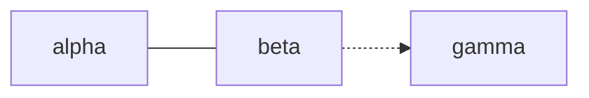

# Repo Verification Implementation Plan

> **For agentic workers:** REQUIRED SUB-SKILL: Use superpowers:subagent-driven-development (recommended) or superpowers:executing-plans to implement this plan task-by-task. Steps use checkbox (`- [ ]`) syntax for tracking.

**Goal:** Make NEXTRACK's rules executable: a repo validator, characterization tests for the library tool, uv tooling, `CLAUDE.md`, and CI.

**Architecture:** `scripts/check_repo.py` is one file in two sections. A loader turns the repo into plain data, with YAML line numbers. A list of rule functions, each registered with a `@rule("<id>")` decorator, returns `Finding`s. Tests live in `tests/`. `conftest.py` builds a tiny valid repo (`mini_repo`) and synthetic audio. Each rule test breaks one thing and pins that rule's findings.

**Tech Stack:** Python 3.14, uv, pyyaml, mutagen, pytest, GitHub Actions.

**Spec:** `docs/superpowers/specs/2026-10-21-repo-verification-design.md`

## Global Constraints

- `pyproject.toml`: `requires-python = ">=3.12"`, `dependencies = ["mutagen>=1.47", "pyyaml>=6.0"]`, `[dependency-groups] dev = ["pytest>=8"]`, `[tool.uv] package = false`, pytest `testpaths = ["tests"]`, `pythonpath = ["scripts"]`. `.python-version` is `3.14`.
- `nextrack_tags.py` behavior does not change. Only the "mutagen not installed" message changes (Task 1). Characterization tests must pass without touching it.
- No audio is ever committed. Tests create synthetic MP3/FLAC files only under `tmp_path`.
- Read every repo text file as UTF-8, with `\r\n` normalized to `\n`, through `check_repo.read_text`.
- Finding output is `path:line: rule-id: message`. `path` is relative to the repo, in POSIX form. `line` is 1-based, or `0` for the whole file. Exit status is `0` when clean and `1` when there are findings.
- Rule ids are exactly as written in the spec, plus `parse-error`.
- Booleans are never accepted where the spec says integer (`isinstance(True, int)` is true in Python; rules must exclude it).
- Commit subjects are in the repo's style: an imperative English sentence (`Add …`, `Fix …`) with no `feat:` prefix. The body explains why. End with the trailer `Co-Authored-By: Claude Opus 5.5 <noreply@anthropic.com>`.
- **Definition of done for each task:** `uv run pytest` passes. From Task 4 on, `uv run scripts/check_repo.py` must also print `ok: …`.
- Language: block prose and pool comments are pt-BR. Code, docs, ids and commit messages are English.

## Review Focus

1. **The repo lives under a dot directory** (a superpowers worktree at `.worktrees/x/`): `links-resolve` must still check every file, because dot-skipping is measured from the repo root. Test in Task 6.
2. **CRLF line endings** (files saved by a Windows editor through WSL): the loader normalizes them, so a CRLF copy of the mini repo is clean. Test in Task 4.
3. **A pool that has only comments** (a new node with no tracks yet): zero entries, no findings, no crash. Test in Task 7.
4. **Wrong YAML types:** a scalar where a list is expected (`neighbors: beta`, `genres: alpha`), a bool (`energy: yes`) or a string (`bpm: "124"`) must produce a schema finding, never a `TypeError`. Tests in Tasks 5, 7 and 8.
5. **A block with missing or unclosed front matter:** a `block-frontmatter` or `parse-error` finding, other block rules skip the file, and no traceback. Tests in Task 8.

---

### Task 1: Tooling and agent instructions

**Files:**
- Create: `pyproject.toml`, `.python-version`, `uv.lock` (generated), `CLAUDE.md`, `tests/test_tooling.py`
- Modify: `.gitignore` (the `# --- Python ---` section), `scripts/nextrack_tags.py:40-46` (the `ImportError` message)

**Interfaces:**
- Produces: the commands `uv sync` and `uv run pytest`. Tests can `import nextrack_tags` directly.

- [ ] **Step 1: Write the failing test** in `tests/test_tooling.py`:

```python
def test_dependencies_and_scripts_import():
    import mutagen, yaml, nextrack_tags
    assert mutagen.version >= (1, 47)
    assert yaml.__version__ >= "6.0"
    assert callable(nextrack_tags.main)
```

- [ ] **Step 2: Run it.** `uv run pytest` → FAIL (uv: no `pyproject.toml` / no project).
- [ ] **Step 3: Create the tooling files.** `pyproject.toml` with exactly the Global Constraints values (`[project] name = "nextrack"`, `version = "0.1.0"`, `description = "DJ set planning as code — repo tooling"`). `.python-version` containing `3.14`. Under `.gitignore`'s `# --- Python ---` section, add `.venv/` and `.worktrees/`. Then run `uv sync`, which writes `uv.lock`.
- [ ] **Step 4: Run.** `uv run pytest -q` → `1 passed`; `uv lock --check` → exit 0.
- [ ] **Step 5: Change the `ImportError` message** in `nextrack_tags.py` to exactly:

```python
    sys.exit(
        "mutagen not installed.\n"
        "  Run:  uv sync   (then: uv run scripts/nextrack_tags.py ...)\n"
        "  Or:   sudo apt-get install -y python3-mutagen"
    )
```

- [ ] **Step 6: Write `CLAUDE.md`** (≤ 120 lines) with these sections, filled from spec §4:
  - `# NEXTRACK — agent instructions`
  - `## What this is`
  - `## Invariants`
  - `## Commands` (the spec §1 table, plus the library-tool rules: dry-run by default; `--apply` writes; edit with mutagen, never ffmpeg; `NEXTRACK_AUDIO_ROOT`)
  - `## Change checklists`
  - `## Definition of done`
  - `## Language`
  - `## Superpowers workflow` (where specs and plans go; which work needs a spec; `.worktrees/` allowed without asking, set up with `uv sync`; `feat/` / `fix/` / `chore/` branches; PR merged with rebase)

  Include the uv install command, `curl -LsSf https://astral.sh/uv/install.sh | sh`. Link only to files that already exist.
- [ ] **Step 7: Run** `uv run pytest -q` → `1 passed`.
- [ ] **Step 8: Commit.** `git add pyproject.toml .python-version uv.lock .gitignore CLAUDE.md tests/test_tooling.py scripts/nextrack_tags.py`, with the message `Add uv tooling and CLAUDE.md agent instructions`.

### Task 2: Characterize nextrack_tags pure functions

**Files:**
- Create: `tests/test_nextrack_tags.py`

**Interfaces:**
- Consumes: `nextrack_tags.clean_stem`, `parse_artist_title`, `normalize`, `to_camelot`, `to_bpm`, `is_junk_title`, `is_junk_artist`, `strip_sitejunk`, `_desired_tags(emb, f_artist, f_title, yaml_hit, overwrite) -> (title, artist)`, `parse_pool(path) -> list[dict]`.

Every value below was checked against the current code on 2026-10-21. If a test fails, the test is wrong. Never edit `nextrack_tags.py` to make a test pass.

- [ ] **Step 1: Write the tests:**
  - **`test_clean_stem`** (parametrized), input → expected:

    | Input | Expected |
    |---|---|
    | `Artist - Title [NotSlider.nl]` | `Artist - Title` |
    | `Artist - Title [vk.com Music]` | `Artist - Title` |
    | `Artist - Title - Tech House` | `Artist - Title` |
    | `Artist - Title - Slap House` | `Artist - Title` |
    | `Artist - Title - Música 2` | `Artist - Title` |
    | `Artist - Title (infantil)` | `Artist - Title` |
    | `Artist - Title [slider.kz] - Tech House` | `Artist - Title` |
    | `Artist - Title [www.site.ru] Deep House` | `Artist - Title` |
    | `Artist - Title (Extended Mix)` | unchanged |
    | `Artist - Title [Salsa Version]` | unchanged |

  - **`test_parse_artist_title`:** `"A - B - C"` → `("A", "B - C")`; `"Solo"` → `(None, "Solo")`.
  - **`test_normalize`:** `"Dançarina!  (Remix)"` → `"dancarina remix"`; `None` → `""`.
  - **`test_to_camelot_covers_the_wheel`:** take the roots `["C","Db","D","Eb","E","F","F#","G","Ab","A","Bb","B"]`. Majors map onto exactly `{f"{n}B" for n in 1..12}`, and each root + `"m"` maps onto exactly `{f"{n}A" for n in 1..12}`.
  - **`test_to_camelot_examples`** (parametrized):

    | Input | Expected |
    |---|---|
    | `C` | `8B` |
    | `Am` | `8A` |
    | `Fm` | `4A` |
    | `Ebm` | `2A` |
    | `F#m` | `11A` |
    | `Gbm` | `11A` |
    | `A#` | `6B` |
    | `F♯m` | `11A` |
    | `B♭` | `6B` |
    | `8a` | `8A` |
    | `12B` | `12B` |
    | `c` | `8B` |
    | `cm` | `5A` |
    | `H`, `""`, `None`, `Cmaj` | `None` |

  - **`test_to_bpm`:** `"123.9"` → `124`, `"124.6"` → `125`, `128` → `128`, `"abc"` → `None`, `None` → `None`.
  - **`test_is_junk_title`:** `""`, `"  "`, `"ab"`, `"Next Song"`, `"current song"` → `True`; `"abc"` → `False`.
  - **`test_is_junk_artist`:** `""`, `"Mix Tutorial"`, `"next song"` → `True`; `"Ivete"` → `False`.
  - **`test_strip_sitejunk`:** `"Title [slider.kz]"` → `"Title"`; `None` → `""`.
  - **`test_desired_tags`** (parametrized), arguments `(emb, f_artist, f_title, yaml_hit, overwrite)` → result:

    | `emb` | `f_artist`, `f_title` | `yaml_hit` | `overwrite` | Result |
    |---|---|---|---|---|
    | `{"title":"Real","artist":"A; B"}` | `"A"`, `"File Title"` | `None` | `False` | `("Real","A; B")` |
    | `{"title":"Next Song","artist":"Mix Tutorial"}` | `"FA"`, `"FT"` | `{"title":"Y T","artist":"Y A"}` | `False` | `("Y T","Y A")` |
    | same | `"FA"`, `"FT"` | `None` | `False` | `("FT","FA")` |
    | `{"title":"Real","artist":"A; B"}` | `"FA"`, `"FT"` | `None` | `True` | `("FT","FA")` |
    | `{"title":"Real [NotSlider.nl]","artist":"A"}` | `"FA"`, `"FT"` | `None` | `False` | `("Real","A")` |

  - **`test_parse_pool`** (`tmp_path`): write this text exactly, then assert `parse_pool` returns:

    ```
    # header comment
    - title: "Sóng A"
      artist: 'Artist One'
      bpm: null
      key: 8A

    - title: Plain Title
      artist: Artist Two
      bpm: 120
      key: null
    ```

    ```python
    [{"title": "Sóng A", "artist": "Artist One", "bpm_line": 3, "bpm_val": "null", "key_line": 4, "key_val": "8A"},
     {"title": "Plain Title", "artist": "Artist Two", "bpm_line": 8, "bpm_val": "120", "key_line": 9, "key_val": "null"}]
    ```

- [ ] **Step 2: Run.** `uv run pytest tests/test_nextrack_tags.py -q` → all pass (characterization).
- [ ] **Step 3: Prove the tests can fail.** Temporarily change `C` → `8B` to `9B`, run, see exactly one failure, then revert.
- [ ] **Step 4: Commit:** `Add characterization tests for nextrack_tags pure functions`.

### Task 3: Characterize nextrack_tags commands with synthetic audio

**Files:**
- Create: `tests/conftest.py`
- Modify: `tests/test_nextrack_tags.py`

**Interfaces:**
- Consumes: `nextrack_tags.main(argv: list[str]) -> None`, which raises `SystemExit` on a missing root.
- Produces (conftest fixtures):
  - `make_mp3` → `(path: Path, *, title=None, artist=None, bpm=None, key=None) -> Path`. Writes an empty file plus an ID3v2.4 tag with the given TIT2/TPE1/TBPM/TKEY and always a `GEOB` frame (`desc="Serato Markers2"`, `mime="application/octet-stream"`, `data=b"\x01\x01cue"`).
  - `make_flac` → `(path: Path, **tags: str) -> Path`.
  - `library` → `tuple[Path, Path]`, returning `(audio_root, tracks_dir)`.

- [ ] **Step 1: Write `tests/conftest.py`.**
  - `make_mp3`: save with `ID3.save(path, v2_version=4)`.
  - `make_flac`: build the minimal file like this, then set tags with `mutagen.flac.FLAC`:

    ```python
    si = struct.pack(">HH", 4096, 4096) + b"\x00" * 6
    si += ((44100 << 44) | (1 << 41) | (15 << 36)).to_bytes(8, "big") + b"\x00" * 16
    path.write_bytes(b"fLaC" + bytes([0x80, 0, 0, 34]) + si)
    ```

  - `library(tmp_path, make_mp3, make_flac)` creates `tmp_path/"library"/"alpha"/` containing:

    | File | Tags |
    |---|---|
    | `Artist One - Song A [NotSlider.nl].mp3` | artist `Artist One`, bpm `124.6`, key `Am` (no title) |
    | `Artist Two - Song B - Tech House.mp3` | title `Next Song`, artist `Mix Tutorial` |
    | `Artist Three - Song C.flac` | `title=Good Title`, `artist=Artist Three`, `bpm=128`, `initialkey=8A` |
    | `Artist Four - Song D.wav` | none (empty file) |
    | `Skank, Dubdogz, Bruno Be - Algo Parecido (Extended).mp3` | bpm `122`, key `Fm` |
    | `Artist X, B - Tune (Remix).mp3` | bpm `120` |
    | `Artist X, C - Tune (Edit).mp3` | bpm `121` |

    It also creates `tmp_path/"tracks"/"alpha.yml"` containing these entries, in this order, after the header comment `# tracks/alpha.yml — pool (unordered).`:

    | `title` | `artist` | `bpm` | `key` | `energy` | `status` |
    |---|---|---|---|---|---|
    | `"Sóng A"` | `"Artist One"` | null | null | 6 | downloaded |
    | `"Song C"` | `"Artist Three"` | null | `5A` | 7 | downloaded |
    | `"Algo Parecido (Remix)"` | `"Skank"` | null | null | 7 | downloaded |
    | `"Tune"` | `"Artist X"` | null | null | 5 | downloaded |
    | `"Song Z"` | `"Nobody"` | null | null | 5 | to-download |

    Every entry has `genre: alpha`. Entries are separated by blank lines, and the field order is `title, artist, genre, bpm, key, energy, status`.
  - Every command test passes `--root <audio_root>` and, where applicable, `--tracks-dir <tracks_dir>`.
- [ ] **Step 2: Write the tests:**
  - **`test_dry_runs_change_nothing`:** snapshot `{path: (bytes, st_mtime_ns)}` for every file under `tmp_path`. Run `audit`, `clean-names`, `fix-tags` and `pull-bpm`, all without `--apply`. The snapshot must be unchanged.
  - **`test_clean_names_apply_renames_and_logs`:**
    - after `--apply`, `alpha/` contains `Artist One - Song A.mp3` and `Artist Two - Song B.mp3`, and the old names are gone;
    - `audio_root/"_nextrack_rename_log.tsv"` has 2 lines, each `old\tnew` with absolute paths.
  - **`test_clean_names_skips_existing_target`:** first create an empty `alpha/Artist One - Song A.mp3`. After `--apply`, the junk-named file still exists and the output contains `SKIP (target exists)`.
  - **`test_fix_tags_apply`:**
    - Song A: `TIT2` is `Sóng A` (the YAML curation wins over the filename) and `TPE1` stays `Artist One`.
    - Song B: `TIT2` is `Song B` and `TPE1` is `Artist Two`.
    - The FLAC keeps `title == ["Good Title"]`.
    - Song A still has `GEOB:Serato Markers2` with `data == b"\x01\x01cue"`, and `ID3(...).version == (2, 4, 0)`.
    - The output contains `SKIP wav`.
  - **`test_fix_tags_overwrite_lets_curated_value_win`:** with `--apply --overwrite`, the FLAC's `title == ["Song C"]`.
  - **`test_pull_bpm_apply`** (`--apply -v`). Re-parse `alpha.yml` with `yaml.safe_load` and check:

    | Entry | `bpm` | `key` |
    |---|---|---|
    | Sóng A | `125` | `8A` |
    | Song C | `128` | `5A` (unchanged) |
    | Algo Parecido (Remix) | `122` | `4A` |
    | Tune | `None` | `None` (ambiguous between two versions) |
    | Song Z | `None` | `None` |

    Also check that the first line is still the header comment, that the order of titles is unchanged, and that the output contains `2 null entries unmatched`.
  - **`test_missing_root_exits_with_hint`:** `monkeypatch.delenv("NEXTRACK_AUDIO_ROOT", raising=False)`. `main(["audit"])` raises `SystemExit` and `"NEXTRACK_AUDIO_ROOT" in str(exc.value.code)`.
- [ ] **Step 3: Run.** `uv run pytest -q` → all pass.
- [ ] **Step 4: Prove the tests can fail.** Temporarily expect `bpm == 124` for Sóng A, see the failure, then revert.
- [ ] **Step 5: Commit:** `Add command tests for nextrack_tags using synthetic MP3/FLAC`.

### Task 4: Validator core — loader, findings, CLI, mini repo

**Files:**
- Create: `scripts/check_repo.py`, `tests/test_check_repo.py`
- Modify: `tests/conftest.py` (add the mini-repo helpers)

**Interfaces:**
- Produces, in `check_repo`:
  - `Finding(path: str, line: int, rule: str, message: str)`: a frozen, ordered dataclass. `str(f)` gives `"path:line: rule: message"`.
  - `Pool(path: str, stem: str, text: str, entries: list[dict])`.
  - `Block(path: str, text: str, has_front: bool, front: dict | None, body: list[tuple[int, str]])`:
    - `body` holds `(1-based line, text)` for the lines after the front matter (or every line when there is none);
    - `front` is `None` when the front matter is missing or failed to parse.
  - `Repo(root: Path, nodes: list[dict], pools: list[Pool], blocks: list[Block], errors: list[Finding])`, with `node_ids() -> set[str]` and `edges() -> list[tuple[str, dict]]`. `edges()` returns `(from_id, edge)` and skips any node whose `neighbors` is not a list and any edge that is not a dict.
  - `read_text(path: Path) -> str` (UTF-8, CRLF → LF).
  - `load_yaml(text: str, first_line: int = 1) -> object`. Every mapping gets `__line__ = mark.line + first_line`. Front matter uses `first_line=2`. Raises `yaml.YAMLError`.
  - `load_repo(root: Path) -> Repo`, `check(root: Path) -> list[Finding]` (sorted), and `main(argv: list[str] | None = None) -> int`.
  - `RULES: list[Callable[[Repo], Iterable[Finding]]]`, plus the decorator `rule(rule_id: str)`, which sets `fn.rule_id` and appends the function to `RULES`.
  - `norm(s: str | None) -> str`, `is_int(v) -> bool` (an int that is not a bool), and `is_range(v, lo: int | None = None, hi: int | None = None, ordered: bool = True) -> bool` (a two-item list of `is_int` values within `[lo, hi]`, with min ≤ max when `ordered`).
- Produces, in `tests/conftest.py`:
  - `REPO_ROOT: Path`.
  - `MINI_REPO_FILES: dict[str, str]` (verbatim below).
  - A `MiniRepo` class with: `root`, `path(rel)`, `read(rel)`, `write(rel, text)`, `edit(rel, old, new)` (asserts `old` occurs exactly once), `line_of(rel, text) -> int` (the 1-based line of the unique occurrence), and `findings(rule: str | None = None) -> list[tuple[str, int, str]]`.
  - A `build_mini_repo(root: Path) -> MiniRepo` function, the fixture `mini_repo` (which builds in `tmp_path / "repo"`), and the fixture `mini_repo_at`, which returns `build_mini_repo`.

`MINI_REPO_FILES`. Each file is shown in its own block below; the content is the block's text plus a trailing newline:

`genres/graph.yml`
```yaml
nodes:
  - id: alpha
    name: Alpha
    family: brazilian
    bpm: [100, 120]
    energy: [4, 8]
    feel: [warm]
    subgenres: [alpha-sub]
    neighbors:
      - {to: beta,  strength: strong, via: "blend on the break"}
      - {to: gamma, strength: weak,   via: "long echo out"}
  - id: beta
    name: Beta
    family: global
    bpm: [118, 126]
    energy: [5, 9]
    neighbors:
      - {to: alpha, strength: strong, via: "drop back to the groove"}
      - {to: gamma, strength: medium, via: "lift the tempo"}
  - id: gamma
    name: Gamma
    family: global
    bpm: [124, 130]
    energy: [6, 9]
    neighbors:
      - {to: beta,  strength: medium, via: "ease down"}
```

`docs/taxonomy.md`
```markdown
# Taxonomy

### `alpha` — Alpha
A warm test genre.

### `beta`
A driving test genre.

### `gamma`
A peak test genre.
```

`docs/genre-graph.md`
````markdown
# Genre graph

See the [taxonomy](taxonomy.md).


````

`tracks/alpha.yml`
```yaml
# tracks/alpha.yml — pool for `alpha` (unordered).

- title: "Dançarina"
  artist: "Pedro Sampaio & MC Pedrinho"
  genre: alpha
  bpm: 135
  key: 8A
  energy: 8
  status: downloaded
  tags: [funk, singalong]

- title: "Voa Voa (Ao Vivo)"
  artist: "Chiclete com Banana"
  genre: alpha
  bpm: null
  key: null
  energy: 7
  status: to-download
  notes: "opens the block"
```

`blocks/alpha-festa.md`
```markdown
---
name: Alpha Festa
function: peak
style: open-format
duration: 30m
genres: [alpha]
bpm: [100, 135]
energy: [7, 8]
key_journey: TBD
lightshow: null
---

## Feel
Bloco de teste.

## Bridge in
← `beta`: hard cut no refrão.

## Tracklist (primary)
1. Pedro Sampaio — Dançarina        · e8  abre
2. Chiclete com Banana — Voa Voa    · e7

## Bridge out
- → `beta`: echo out.
- Ver `alpha-festa.md` (não é um node).
```

`README.md`
```markdown
# Mini repo

Read the [genre graph](docs/genre-graph.md).
```

- [ ] **Step 1: Write the failing tests** in `tests/test_check_repo.py`:
  - **`test_mini_repo_is_clean`:** `mini_repo.findings() == []`.
  - **`test_real_repo_is_clean`:** `[str(f) for f in check(REPO_ROOT)] == []`.
  - **`test_loader_records_lines`:** for `load_repo(mini_repo.root)`:
    - `nodes[0]["__line__"] == line_of("genres/graph.yml", "- id: alpha")`;
    - the first edge's `__line__ == line_of(..., "{to: beta,  strength: strong")`;
    - `pools[0].entries[1]["__line__"] == line_of("tracks/alpha.yml", "Voa Voa")`;
    - `blocks[0].front["__line__"] == 2`.
  - **`test_cli_clean`:** `main(["--repo", str(root)]) == 0`, and the last stdout line is `ok: 3 nodes, 5 edges, 2 tracks, 1 blocks`.
  - **`test_cli_reports_parse_error`:**
    - in `genres/graph.yml`, replace `    bpm: [100, 120]` with `    bpm: [100, 120`;
    - `main(...) == 1`;
    - one stdout line matches `^genres/graph\.yml:\d+: parse-error: `;
    - the last line is `1 problem(s)`.
  - **`test_parse_errors_never_raise`:** break `tracks/alpha.yml` (append `- title: [`) and the block's front matter (`genres: [alpha` without `]`). `check()` returns `parse-error` findings for both paths, and the run raises nothing.
  - **`test_crlf_repo_is_clean`** (Review Focus 2): rewrite every mini-repo file with `\r\n` line endings; `findings() == []`.
- [ ] **Step 2: Run them.** `uv run pytest tests/test_check_repo.py -q` → FAIL (`ModuleNotFoundError: check_repo`).
- [ ] **Step 3: Implement `scripts/check_repo.py`.**
  - Follow `nextrack_tags.py`'s style: shebang, a module docstring, and `# ---- section ----` comment rulers.
  - Loader:
    - Graph: `genres/graph.yml` → `nodes`.
    - Pools: `tracks/*.yml`, sorted. A file that parses to `None` has zero entries.
    - Blocks: `blocks/*.md`, sorted, excluding `README.md`. `has_front` is true when the text starts with `---\n`. The front matter ends at the next line that is exactly `---`; no closing line → `parse-error`, "unclosed front matter".
    - Every load failure becomes `Finding(rel, line_from_yaml_mark_or_0, "parse-error", msg)`.
  - CLI: `--repo` defaults to `Path(__file__).resolve().parent.parent`. Print each finding, then `N problem(s)` or the `ok:` line. Counts:
    - `nodes` is `len(repo.nodes)`;
    - `edges` is `len(repo.edges())`;
    - `tracks` is the total number of pool entries;
    - `blocks` is `len(repo.blocks)`.
  - End with `if __name__ == "__main__": sys.exit(main())`.
- [ ] **Step 4: Run.** `uv run pytest -q` → all pass. `uv run scripts/check_repo.py` → `ok: 23 nodes, 106 edges, 220 tracks, 5 blocks`.
- [ ] **Step 5: Commit:** `Add check_repo.py validator core and mini-repo test fixture`.

### Task 5: Graph rules

**Files:**
- Modify: `scripts/check_repo.py`, `tests/test_check_repo.py`

**Interfaces:**
- Consumes: `Repo`, `Finding`, `rule`, `is_int`, `is_range` from Task 4; the `mini_repo` fixture.
- Produces: the rules `graph-node-schema`, `graph-unique-ids`, `graph-edge-schema`, `graph-edges-resolve` and `graph-node-connected`, implementing the spec's Graph table. Node findings use the node's `__line__`; edge findings use the edge's `__line__`. Rules ignore the `__line__` key when checking which keys are allowed.

Each test applies one `edit` to `genres/graph.yml` and asserts `mini_repo.findings("<rule>") == [("genres/graph.yml", L, "<rule>")]`. `L` is computed with `line_of` on the line given in each table.

- [ ] **Step 1: Write the failing tests.**
  - **`test_graph_node_schema`**, parametrized; `L` is the line of the node named in the change:

    | Change | Line for `L` |
    |---|---|
    | delete the line `    name: Beta` | `- id: beta` |
    | `    name: Gamma\n    family: global` → `    name: Gamma\n    family: world` | `- id: gamma` |
    | `bpm: [124, 130]` → `bpm: [130, 124]` | `- id: gamma` |
    | `energy: [6, 9]` → `energy: [0, 9]` | `- id: gamma` |
    | `energy: [4, 8]` → `energy: [yes, 8]` (bool) | `- id: alpha` |
    | add the line `    colour: red` after `    name: Gamma` | `- id: gamma` |
    | `    neighbors:\n      - {to: beta,  strength: medium, via: "ease down"}` → `    neighbors: beta` (Review Focus 4; also assert nothing raises) | `- id: gamma` |

  - **`test_graph_unique_ids`:** append a copy of the whole gamma node (its 6 lines) to the end of the file. `L` is the copy's first line, `original_line_count + 1`; `line_of` can't find it because the text is no longer unique.
  - **`test_graph_edge_schema`**, parametrized; `L` is the edited edge's line:

    | Change |
    |---|
    | `strength: medium, via: "ease down"` → `strength: solid, via: "ease down"` |
    | `via: "ease down"` → `via: ""` |
    | `via: "ease down"}` → `via: "ease down", note: 1}` |

  - **`test_graph_edges_resolve`**, parametrized; `L` is the added or edited edge's line:

    | Change |
    |---|
    | `{to: beta,  strength: medium` → `{to: delta, strength: medium` |
    | add `      - {to: gamma, strength: weak, via: "self"}` under gamma's neighbors (a self edge) |
    | add a second `      - {to: beta, strength: weak, via: "again"}` under gamma (a duplicate target) |

  - **`test_graph_node_connected`:** replace gamma's `neighbors:` list with `neighbors: []`. `L` is the line of `- id: gamma`.
- [ ] **Step 2: Run.** `uv run pytest tests/test_check_repo.py -q -k graph` → FAIL (no findings).
- [ ] **Step 3: Implement the five rules** with `@rule(...)`. Every type check goes through `is_int` / `is_range` / `isinstance`; nothing may raise on a wrong type.
- [ ] **Step 4: Run.** `uv run pytest -q` → all pass, including `test_real_repo_is_clean`. `uv run scripts/check_repo.py` → `ok: …`.
- [ ] **Step 5: Commit:** `Add graph rules to check_repo`.

### Task 6: Docs rules, Mermaid cleanup, graph docs

**Files:**
- Modify: `scripts/check_repo.py`, `tests/test_check_repo.py`, `docs/genre-graph.md`, `genres/README.md`

**Interfaces:**
- Consumes: Task 4 helpers; `Repo.edges()` for the strongest strength of each pair.
- Produces: the rules `taxonomy-matches-graph`, `mermaid-matches-graph` and `links-resolve`, implementing the spec's Docs table.
  - Line attribution: a missing taxonomy heading → line 0. A missing Mermaid declaration or pair → the line of the ` ```mermaid ` fence. Everything else → the offending line.
  - Mermaid parsing: a declaration matches `^\s*(\w+)\["([^"]+)"\]\s*$`; an edge matches `^\s*(\w+)\s+(---|-\.->)\s+(\w+)\s*$`; other lines (`graph`, `subgraph`, `end`) are ignored.
  - Links: blank out fenced code and inline code spans while keeping the line count. A link matches `\[[^\]]*\]\(([^)\s]+)\)`. Drop `#anchor`, and skip empty targets and anything matching `^[a-z][a-z0-9+.-]*:`.

- [ ] **Step 1: Write the failing tests**, each pinning only its own rule:
  - **`test_taxonomy_missing_heading`:** delete the `### \`gamma\`` line → `("docs/taxonomy.md", 0, ...)`.
  - **`test_taxonomy_stale_heading`:** append `\n### \`delta\`\nGone.` → the line of `### \`delta\``.
  - **`test_mermaid`**, parametrized over `docs/genre-graph.md` edits; the expected line is listed for each. "Add" means insert the line just before the block's closing ` ``` ` (edit `  B -.-> G\n```` → `  B -.-> G\n<line>\n````).

    | Change | Expected line |
    |---|---|
    | delete `  G["gamma"]` | three findings: two at the fence line (gamma not declared; the beta–gamma pair not drawn) and one at the `  B -.-> G` line (undeclared alias) |
    | add `  D["delta"]` | that line |
    | add `  B --- A` | that line (a pair drawn twice) |
    | `  B -.-> G` → `  B --- G` | that line (the wrong style) |
    | delete `  A --- B` | the fence line (a missing pair) |
    | add `  A -.-> G` | that line (a weak pair is drawn) |

  - **`test_links_resolve`:**
    - appending `[x](missing.md)` to `README.md` → one finding at that line;
    - each of these, appended, gives no finding: `` `[x](missing.md)` ``, a fenced block containing `[x](missing.md)`, `[x](#top)`, `[x](https://example.com)`, `[t](docs/taxonomy.md#alpha)`.
  - **`test_links_checked_when_repo_lives_under_dot_dir`** (Review Focus 1): `mini_repo_at(tmp_path / ".worktrees" / "x")`, append `[x](missing.md)` to `README.md` → one `links-resolve` finding.
- [ ] **Step 2: Run.** `uv run pytest tests/test_check_repo.py -q` → the new tests FAIL.
- [ ] **Step 3: Implement the three rules.**
- [ ] **Step 4: Run** `uv run scripts/check_repo.py` → six `mermaid-matches-graph` findings for the pairs drawn twice. Delete the later line of each pair in `docs/genre-graph.md`: `MPB --- SAMBA`, `ORG --- AFROBR`, `TECH --- BBASS`, `AFRO --- AFROBR`, `MELO --- BBASS`, `GBASS --- FUNK`. Re-run → `ok: …`. Any other finding means the data is wrong: fix the data, per the spec's "Data fixes" section, and note it in the commit body.
- [ ] **Step 5: Update the graph docs.**
  - `docs/genre-graph.md`, "Growing the graph": step 2 also adds the `` ### `id` `` taxonomy heading, a new step 3 adds the Mermaid declaration and lines (solid for strong, dashed for medium, nothing for weak), and the last step is `uv run scripts/check_repo.py`.
  - `genres/README.md`, "Conventions": a bullet pointing to the validator.
- [ ] **Step 6: Run** `uv run pytest -q` → all pass.
- [ ] **Step 7: Commit:** `Add docs rules to check_repo; drop duplicate Mermaid lines`.

### Task 7: Pool rules

**Files:**
- Modify: `scripts/check_repo.py`, `tests/test_check_repo.py`, `tracks/README.md`

**Interfaces:**
- Consumes: Task 4 helpers (`norm`, `is_int`), and `Pool.entries` with `__line__`.
- Produces: the rules `pool-file-is-node`, `track-schema`, `track-genre-matches-pool`, `track-title-first` and `track-unique`, implementing the spec's Pools table.
  - Entry findings use the entry's `__line__`; file findings use line 0.
  - The `track-unique` message names the first occurrence as `path:line`.

- [ ] **Step 1: Write the failing tests:**
  - **`test_pool_file_is_node`:** write `tracks/delta.yml` with one valid entry whose `genre: delta` → `("tracks/delta.yml", 0, ...)`.
  - **`test_track_schema`**, parametrized over `tracks/alpha.yml` edits. Each finding is at the edited entry's `- title:` line.

    | Change | Clause |
    |---|---|
    | delete `  status: to-download` | missing status |
    | `status: to-download` → `status: lost` | bad status value |
    | `bpm: 135` → `bpm: "135"` | string bpm (Review Focus 4) |
    | `bpm: 135` → `bpm: 0` | bpm out of range |
    | `key: 8A` → `key: 13A` | invalid Camelot number |
    | `key: 8A` → `key: 8C` | invalid Camelot letter |
    | `energy: 8` → `energy: 11` | energy out of range |
    | `energy: 8` → `energy: yes` | bool energy (Review Focus 4) |
    | add `  artsit: "x"` after `notes:` | unknown key |
    | `title: "Dançarina"` → `title: ""` | empty title |
    | delete `  bpm: null` | bpm must be present |
    | `tags: [funk, singalong]` → `tags: funk` | tags not a list |

  - **`test_track_genre_matches_pool`:** the second entry's `genre: alpha` → `genre: beta`.
  - **`test_track_title_first`:** replace `- title: "Voa Voa (Ao Vivo)"\n  artist: "Chiclete com Banana"` with `- artist: "Chiclete com Banana"\n  title: "Voa Voa (Ao Vivo)"` → a finding at that entry's line.
  - **`test_track_unique`:**
    - within a pool: append a copy of the first entry with `title: "DANÇARINA"` → a finding at the copy's line whose message contains `tracks/alpha.yml:3`;
    - across pools: write `tracks/beta.yml` with the same track (`genre: beta`) → a finding in `tracks/beta.yml`.
  - **`test_comment_only_pool_is_clean`** (Review Focus 3): write `tracks/beta.yml` as `# beta — vazio por enquanto\n` → `mini_repo.findings() == []`.
- [ ] **Step 2: Run** → the new tests FAIL.
- [ ] **Step 3: Implement the five rules.**
- [ ] **Step 4: Update `tracks/README.md`.** Under "Field notes": entries start with `- title:`; the allowed fields are exactly the spec list; `bpm`/`key` are present even when null; the validator checks all of this.
- [ ] **Step 5: Run** `uv run pytest -q` and `uv run scripts/check_repo.py` → all pass, and `ok: …`.
- [ ] **Step 6: Commit:** `Add pool and track rules to check_repo`.

### Task 8: Block rules

**Files:**
- Modify: `scripts/check_repo.py`, `tests/test_check_repo.py`, `blocks/README.md`

**Interfaces:**
- Consumes: `Block` (`has_front`, `front`, `body`), and `norm`, `Repo.edges()` and `node_ids()` from Task 4.
- Produces:
  - The rules `block-frontmatter`, `block-tracklist-resolves` and `block-bridges-are-edges`, implementing the spec's Blocks table.
  - The helpers `core(title: str) -> str`, `artist_tokens(artist: str) -> set[str]` (with `JOINERS = {"feat","ft","x","e","and","com","pres","vs"}`), and `section(body, prefix: str) -> list[tuple[int, str]] | None`. `section` returns the lines after the first heading that starts with `prefix`, up to the next `## ` heading, or `None` when there is no such heading.
  - Line attribution:
    - front-matter findings → `front["__line__"]` (2);
    - no front matter → line 1;
    - no Tracklist heading → line 0;
    - tracklist and bridge findings → their own line.
  - Blocks with `front is None and has_front` (a parse error) are skipped by all three rules.

- [ ] **Step 1: Write the failing tests:**
  - **`test_block_frontmatter`**, parametrized over front-matter edits; expect `("blocks/alpha-festa.md", 2, ...)`:

    | Change |
    |---|
    | `function: peak` → `function: party` |
    | `style: open-format` → `style: blend` |
    | `duration: 30m` → `duration: 30 minutes` |
    | `genres: [alpha]` → `genres: [delta]` |
    | `genres: [alpha]` → `genres: alpha` (Review Focus 4) |
    | `bpm: [100, 135]` → `bpm: [135, 100]` |
    | `energy: [7, 8]` → `energy: [0, 8]` |
    | delete `key_journey: TBD` |
    | add `mood: hot` on the line after `lightshow: null` |
    | `lightshow: null` → `lightshow: ../lightshows/alpha-festa.md` (the file doesn't exist) |

  - **`test_block_frontmatter_accepts`:** none of these produce findings: `energy: [8, 7]` (a falling arc); and `lightshow: ../lightshows/alpha-festa.md` after writing that file.
  - **`test_block_without_frontmatter`** (Review Focus 5): delete the whole front-matter block, including both `---` lines → `[("blocks/alpha-festa.md", 1, "block-frontmatter")]`, and nothing raises.
  - **`test_block_unclosed_frontmatter`** (Review Focus 5): delete only the closing `---` → a `parse-error` for the block, and `[f for f in findings() if f[2].startswith("block-")] == []`.
  - **`test_block_tracklist`:**
    - adding (on the line after tracklist entry 2) `3. Nobody — Ghost Track · e5` → a finding at that line whose message starts with `unresolved:`;
    - adding `3. Nobody - Ghost Track · e5` → a finding at that line whose message starts with `format:`;
    - renaming `## Tracklist (primary)` to `## Lista` → a finding at line 0;
    - replacing line 1 with `1. PEDRO SAMPAIO — DANCARINA · e8` → no finding (case and accent folding).
  - **`test_block_bridges`:**
    - adding `← \`gamma\`: corte.` on the line after `← \`beta\`: hard cut no refrão.` → a finding at that line (there is no gamma→alpha edge);
    - adding `- → \`gamma\`: lift.` under Bridge out → no finding (the weak alpha→gamma edge counts);
    - adding `` `alpha` `` anywhere in Bridge out → no finding (the block's own genre).
- [ ] **Step 2: Run** → the new tests FAIL.
- [ ] **Step 3: Implement the helpers and the three rules.**
- [ ] **Step 4: Update `blocks/README.md`.** Add a section `## Machine-checked formats`:
  - the tracklist line `N. Artist — Title · …` (em dash, then a middle dot);
  - the line must match a pool track;
  - backticked node ids in Bridge in/out must follow graph edges;
  - Swap options stay free-form;
  - run `uv run scripts/check_repo.py`.
- [ ] **Step 5: Run** `uv run pytest -q` and `uv run scripts/check_repo.py` → all pass, and `ok: …`.
- [ ] **Step 6: Commit:** `Add block rules to check_repo`.

### Task 9: CI and tooling docs

**Files:**
- Create: `.github/workflows/checks.yml`
- Modify: `scripts/README.md`, `README.md`, `tests/test_tooling.py`, and `CLAUDE.md` (only if a command changed)

**Interfaces:**
- Consumes: `check_repo.RULES` (each function has `.rule_id`).

- [ ] **Step 1: Write the failing test** `test_scripts_readme_lists_every_rule` in `tests/test_tooling.py`: every `fn.rule_id` in `check_repo.RULES`, plus `parse-error`, appears in `scripts/README.md` as `` `rule-id` ``.
- [ ] **Step 2: Run** → FAIL.
- [ ] **Step 3: Update `scripts/README.md`.**
  - "Install": `uv sync` comes first, then apt as an alternative.
  - New section `## check_repo.py`: what it validates, the commands, the output format and exit codes, and a table of every rule id with one line each.
- [ ] **Step 4: Create `.github/workflows/checks.yml`:**

```yaml
name: checks
on:
  push:
  pull_request:
jobs:
  checks:
    runs-on: ubuntu-latest
    steps:
      - uses: actions/checkout@v7
      - uses: astral-sh/setup-uv@v10.3.1
      - run: uv sync --locked
      - run: uv run scripts/check_repo.py
      - run: uv run pytest
```

- [ ] **Step 5: Update `README.md`.** In the "Repo layout" tree, add `CLAUDE.md`, `pyproject.toml` and `tests/`. Add a fifth "Quickstart" step: `uv sync`, then `uv run scripts/check_repo.py`, before committing. Check that `CLAUDE.md`'s commands match what now exists.
- [ ] **Step 6: Verify the whole branch the way CI will:** `uv sync --locked && uv run scripts/check_repo.py && uv run pytest -q` → `ok: …` and all pass. `python3 -c "import yaml; yaml.safe_load(open('.github/workflows/checks.yml'))"` → no error.
- [ ] **Step 7: Commit:** `Add GitHub Actions checks and document check_repo rules`.
